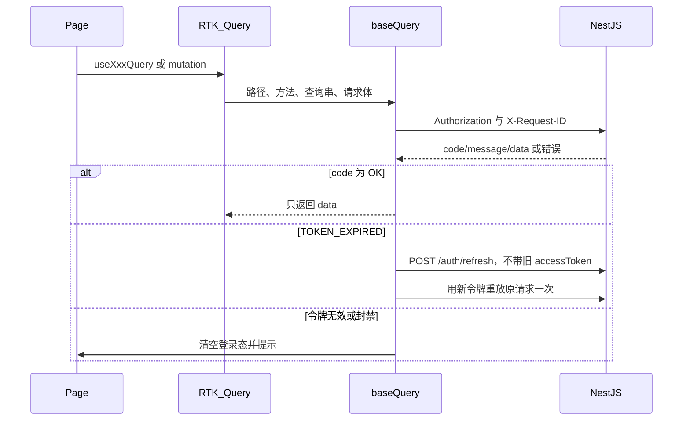

# 纯爱健康客户端前端架构

本文说明 `client` 目录里的客户端是怎么分层、怎么路由、怎么保存登录态、怎么调用后端的。管理端不在这个工程里。

接口字段、状态机和错误码以仓库根目录的设计文档为准：

- [00-conventions.md](00-conventions.md)：鉴权、金额、幂等、角色边界
- [01-api-reference.md](01-api-reference.md)：方法、路径、是否登录
- [02-data-models.md](02-data-models.md)：对象字段
- [03-business-flows.md](03-business-flows.md)：下单、支付、售后、会员、问答流程

前端类型写在 [client/src/api/types.ts](client/src/api/types.ts)，只覆盖客户端会用到的对象。

## 1. 工程在做什么

这是一个浏览器里的单页应用，品牌名是「纯爱健康」。它提供五个主入口：

| 入口 | 路径 | 谁可以看 |
|---|---|---|
| 科普内容 | `/science` | 游客和登录用户 |
| 付费课程 | `/courses` | 游客可看介绍和预览；完整章节按权益 |
| 精选产品 | `/products` | 游客可浏览；购买必须登录 |
| AI 问答 | `/ai` | 必须登录 |
| 用户中心 | `/account` | 必须登录 |

页面上固定有一句边界说明：健康知识辅助，不提供诊断、处方或在线问诊。

业务上有几条硬约束，界面不能绕过：

- 科普免费。课程可以免费、单独购买，或「会员或购买」二选一。
- 产品、课程、会员分开下单，不能混在一张订单里。没有购物车、优惠券。
- 金额、运费、库存、退款金额都由服务端计算。前端只展示，不提交价格。
- 支付是否成功以订单查询为准。页面不能自己把订单标成已支付。
- 短信登录和忘记密码的接口当前未开放，界面不提供入口。已登录用户在账号安全里用旧密码改密。

## 2. 技术栈

| 用途 | 选择 | 所在位置 |
|---|---|---|
| 构建 | Vite 6 | [client/vite.config.ts](client/vite.config.ts) |
| 界面 | React 18 + TypeScript | `client/src` |
| 组件 | Ant Design 5，中文语言包 | [client/src/main.tsx](client/src/main.tsx)、[client/src/theme.ts](client/src/theme.ts) |
| 路由 | React Router 7，`createBrowserRouter` | [client/src/router.tsx](client/src/router.tsx) |
| 全局状态与请求缓存 | Redux Toolkit + RTK Query | [client/src/store](client/src/store)、[client/src/api/api.ts](client/src/api/api.ts) |
| 时间 | dayjs，展示时区 Asia/Shanghai | [client/src/lib/format.ts](client/src/lib/format.ts) |
| 富文本 | DOMPurify 清洗后再渲染 | [client/src/components/HtmlContent.tsx](client/src/components/HtmlContent.tsx) |
| 视频 | 原生 `video`；`.m3u8` 用 hls.js | [client/src/components/VideoPlayer.tsx](client/src/components/VideoPlayer.tsx) |
| 省市区 | `element-china-area-data`，提交前补成 6 位行政区划码 | [client/src/lib/region.ts](client/src/lib/region.ts) |
| 支付二维码 | Ant Design `QRCode` | 支付页 |

脚本：

```text
cd client
npm install
npm run dev      # http://127.0.0.1:5173
npm run build    # 先 tsc --noEmit，再 vite build
npm run preview
```

开发时代理把浏览器里的 `/api` 转到公网服务 `http://47.97.46.242`，并改写 Host。前端代码里的接口前缀默认是 `/api/v1`。如果设置了环境变量 `VITE_API_BASE`，则改用这个绝对地址，不再走相对路径。定义在 [client/src/api/config.ts](client/src/api/config.ts)。

生产构建不会带上 Vite 代理。部署时要么把前端和 API 放在同一域名下，由网关把 `/api` 转到后端；要么在构建时把 `VITE_API_BASE` 设成完整的 API 根地址，并让后端允许该前端来源的跨域请求。

## 3. 目录

```text
client/
  index.html                 页面入口，语言 zh-CN
  vite.config.ts             开发服务器与 /api 代理
  src/
    main.tsx                 Redux、Ant Design、路由的组装点
    router.tsx               全部路由
    theme.ts                 主题色与圆角
    index.css                顶栏、页面宽度、科普封面、问答气泡
    api/
      config.ts              API 根地址
      types.ts               与数据文档对应的 TypeScript 类型
      baseQuery.ts           统一请求、拆包、刷新令牌
      api.ts                 RTK Query 的全部客户端接口
      sse.ts                 AI 回答的流式读取
      authEvents.ts          退出时清空接口缓存的回调
    store/
      index.ts               store 组装
      authSlice.ts           登录态
      hooks.ts               useAppDispatch / useAppSelector
    components/              跨页面的壳、卡片、播放器、地址表单
    pages/
      auth/                  登录、注册、协议
      browse/                科普、课程、专栏、章节
      shop/                  产品与结算
      account/               用户中心
      ai/                    问答
    lib/                     金额、时间、文案、错误、幂等键、上传、区划
```

页面按业务分目录，不按「列表/详情」拆一层公共页面工厂。科普详情和课程详情的接口不同，所以是各自的页面，共用卡片、价格、访问提示和播放器。

## 4. 运行时怎么串起来

浏览器加载 `index.html`，执行 `src/main.tsx`。组件从外到内是：

```text
StrictMode
  Redux Provider
    Ant Design ConfigProvider（中文、主题、按钮不自动插空格）
      Ant Design App（提供 message 上下文）
        RouterProvider
          AppShell（顶栏 + 免责声明 + 子路由）
```

`StrictMode` 在开发环境会让效果函数执行两次。因此创建订单、发起支付、发送提问都放在按钮点击里，不放在 `useEffect` 里自动提交。播放地址、轮询和流式连接放在效果函数里时，清理函数会拆掉播放器、定时器和 `AbortController`。

顶栏高亮规则在 [client/src/components/AppShell.tsx](client/src/components/AppShell.tsx) 的 `navKey`：

- `/science`、`/columns`、`/content` 高亮「科普内容」
- `/courses` 高亮「付费课程」。用户中心里的 `/account/courses` 不以 `/courses` 开头，所以不会误亮
- `/products`、`/checkout` 高亮「精选产品」
- `/ai` 高亮「AI问答」
- `/account` 高亮「用户中心」

右上角：

- 未登录：只显示「登录」
- 已登录但会员无效：显示「开通会员」、消息铃铛、头像菜单
- 已登录且 `user.membership.active`：金色标签「会员至 {上海时间}」

消息未读数在已登录时每 60 秒请求一次 `GET /me/notifications/unread-count`。这个接口若尚未实现，角标保持 0，不挡住页面。

退出登录先调用 `POST /auth/logout`。无论接口成功还是失败，都清空本地会话和 RTK Query 缓存，再回到科普首页。这样换账号后不会看到上一个用户的订单或正文缓存。

## 5. 路由

路由表在 [client/src/router.tsx](client/src/router.tsx)。根路径重定向到 `/science`。未知路径显示「页面不存在」。

```mermaid
flowchart TD
  shell[AppShell]
  shell --> science["/science 科普列表"]
  shell --> video["/science/videos/:id"]
  shell --> article["/science/articles/:id"]
  shell --> column["/columns/:id"]
  shell --> content["/content/:id 先判断类型再跳转"]
  shell --> courses["/courses"]
  shell --> course["/courses/:id"]
  shell --> chapter["/courses/:courseId/chapters/:chapterId"]
  shell --> products["/products"]
  shell --> product["/products/:id"]
  shell --> checkout["/checkout 需登录"]
  shell --> ai["/ai 需登录"]
  shell --> login["/login"]
  shell --> register["/register"]
  shell --> legal["/legal/TERMS 或 PRIVACY"]
  shell --> account["/account 需登录"]
  account --> overview[概览]
  account --> orders[订单与支付物流]
  account --> address[地址]
  account --> aftersale[售后]
  account --> owned[已购课程]
  account --> member[会员]
  account --> notice[消息]
  account --> security[账号安全]
```



需要登录的路由包在 `RequireAuth` 里。它看的是 `accessToken`，不是用户资料对象。会话还没恢复完成时先不渲染，避免刷新页面的一瞬间被踢去登录。未登录则跳到 `/login`，并用 `location.state.from` 记下原来的路径和查询串。登录成功后回到该地址；没有来源时进入用户中心。

用户中心内部还有左侧菜单，定义在 [client/src/pages/account/AccountLayout.tsx](client/src/pages/account/AccountLayout.tsx)。选中项按最长路径前缀匹配，所以 `/account/orders/123/pay` 仍高亮「我的订单」，`/account/aftersales/new` 仍高亮「售后」。

`/account/aftersales/new` 写在 `/account/aftersales/:id` 前面。React Router 会优先匹配静态段 `new`，不会把 `new` 当成售后单号。

## 6. 页面与接口对应

筛选条件尽量放在 URL 查询串里，刷新或分享链接能保留页码、关键词和分类。金额筛选在地址栏里用元，请求前换成整数分。

### 科普与专栏

| 页面 | 文件 | 主要请求 |
|---|---|---|
| 科普列表 | `pages/browse/SciencePage.tsx` | `GET /categories?scope=CONTENT`、`GET /columns`、视频或图文列表 |
| 视频科普详情 | `pages/browse/ScienceDetailPage.tsx` | `GET /videos/:id`，可看时再 `GET /videos/:id/playback` |
| 图文科普详情 | 同上，`media="article"` | `GET /articles/:id`，可看时再 `GET /articles/:id/body` |
| 专栏 | `pages/browse/ColumnDetailPage.tsx` | `GET /columns/:id`、`GET /columns/:id/contents` |
| 通知里的内容跳转 | `pages/browse/ContentRedirectPage.tsx` | 先查视频详情，404 再查图文，然后替换到正确地址 |

科普列表用两个 Tab：视频走 `/videos?kind=SCIENCE_VIDEO`，图文走 `/articles?kind=SCIENCE_ARTICLE`。专栏本身不售卖，卡片只负责把人带到内容页。

### 课程

| 页面 | 文件 | 主要请求 |
|---|---|---|
| 课程列表 | `pages/browse/CourseListPage.tsx` | `kind=VIDEO_COURSE` 或 `ARTICLE_COURSE`，可按访问策略和价格排序 |
| 课程详情 | `pages/browse/CourseDetailPage.tsx` | 先 `GET /videos/:id`；若业务码是资源不存在，再 `GET /articles/:id`。目录用 `GET /courses/:id/chapters` |
| 章节学习 | `pages/browse/ChapterPage.tsx` | 视频章节 `GET /chapters/:id/playback`，图文章节 `GET /chapters/:id/body` |

详情接口里的 `access` 决定按钮：

- `canAccess=true`：直接播放或展示正文
- `LOGIN_REQUIRED`：去登录
- `PURCHASE_REQUIRED`：去结算页购买；若策略是 `MEMBER_OR_PURCHASE`，同时给出开通会员
- `CONTENT_UNAVAILABLE`：提示暂不可用

播放地址和正文不写进长期缓存。播放查询的 `keepUnusedDataFor` 是 0，离开页面就丢掉短时 URL。正文和播放接口返回 401/403 时，章节页改显示购买或登录，而不是只显示一条原始错误。

已购课程列表来自 `GET /me/courses`，点进去仍是 `/courses/:id`。下架课程只要购买权益还在，带登录态请求同一个详情接口即可，不另做一套地址。

### 产品与结算

| 页面 | 文件 | 主要请求 |
|---|---|---|
| 产品列表 | `pages/shop/ProductListPage.tsx` | `GET /categories?scope=PRODUCT`、`GET /products` |
| 产品详情 | `pages/shop/ProductDetailPage.tsx` | `GET /products/:id`，选择 SKU 和数量 |
| 结算 | `pages/shop/CheckoutPage.tsx` | `POST /order-quotes`，确认后 `POST /orders` |

立即购买的地址是：

```text
/checkout?type=product&productId=...&skuId=...&quantity=...
/checkout?type=course&courseId=...
/checkout?type=membership&planId=...
```

实物订单必须先有收货地址。结算页不自动在进入时创建订单。用户先点「计算金额」，看到服务端返回的商品金额、运费、应付和 10 分钟有效期，再点「提交订单」。试算过期或业务码 `QUOTE_EXPIRED` 时要求重新计算。已购买过的课程若返回 `COURSE_ALREADY_PURCHASED`，直接进入该课程。

### 订单、支付、物流、售后

这些页面都在用户中心：

| 页面 | 文件 | 行为 |
|---|---|---|
| 订单列表 | `pages/account/OrderListPage.tsx` | 按类型、履约状态筛选 |
| 订单详情 | `pages/account/OrderDetailPage.tsx` | 按钮只看服务端 `actions` |
| 支付 | `pages/account/PaymentPage.tsx` | 微信二维码或支付宝跳转，并轮询 |
| 物流 | `pages/account/LogisticsPage.tsx` | 时间线；未发货和同步失败有不同提示 |
| 申请售后 | `pages/account/AfterSaleCreatePage.tsx` | 未发货仅退款，已发货退货退款 |
| 售后详情 | `pages/account/AfterSaleDetailPage.tsx` | 撤销、填写退货运单、查看凭证 |

`actions` 四个开关：`canPay`、`canCancel`、`canConfirmReceipt`、`canApplyAfterSale`。取消和确认收货都提交刚才读到的 `version`。

支付渠道只有 `WECHAT_NATIVE` 和 `ALIPAY_PAGE`。微信把 `launchUrl` 画成二维码。支付宝在新窗口打开，并用 `sessionStorage` 记住这次支付尝试，避免开发环境严格模式把窗口打开两次。待支付订单每 3 秒重新读取订单和支付尝试。用户点「我已支付」时调用 `POST /payment-attempts/:id/sync`，由服务端向渠道查单。订单离开待支付且不是已取消后，使会员、已购课程和本人资料缓存失效，以便会员和课程权益马上显示出来。

物流的 `syncStatus`：

- `NOT_SHIPPED`：尚未发货
- `UP_TO_DATE`：已更新
- `PENDING`：正在同步
- `FAILED`：展示最近一次记录，并说明暂时无法更新

售后不让用户填退款金额。未发货订单类型固定为 `REFUND_ONLY`，已发货为 `RETURN_REFUND`。数量上限先按「购买数量减已退款数量」限制，真正是否还能申请由服务端判断。凭证图片走上传流程，拿到 `READY` 的媒体 ID 后再提交。查看凭证时调用 `POST /media/:id/read-grant`，只用返回的短时地址，不存下来。

### 会员、消息、账号

| 页面 | 文件 | 行为 |
|---|---|---|
| 概览 | `pages/account/OverviewPage.tsx` | 脱敏手机、会员、今日问答额度、改昵称、换头像 |
| 会员 | `pages/account/MembershipPage.tsx` | 方案列表，购买进入结算 |
| 已购课程 | `pages/account/PurchasedCoursesPage.tsx` | 有效或已撤销 |
| 消息 | `pages/account/NotificationsPage.tsx` | 单条已读、按打开时刻全部已读、删除 |
| 地址 | `pages/account/AddressPage.tsx` | 增删改，编辑必须带 `version` |
| 账号安全 | `pages/account/SecurityPage.tsx` | 旧密码改新密码、设备会话撤销 |

全部已读使用打开消息页那一刻的 UTC 时间作为 `before`，只标记这个时间点及之前的消息，避免把刚到达的新消息一并标掉。

消息点击后按 `target.type` 跳转，规则在 [client/src/lib/contentPath.ts](client/src/lib/contentPath.ts)：

| target.type | 去向 |
|---|---|
| `ORDER` | `/account/orders/:resourceId` |
| `AFTERSALE` | `/account/aftersales/:resourceId` |
| `CONTENT` | `/content/:resourceId`，再分辨视频或图文 |
| `MEMBERSHIP` | `/account/membership` |
| `NONE` | 留在消息页 |

改密成功后服务端会使全部设备失效，前端直接清本地会话并回到登录页，不再调用退出接口。撤销「当前设备」会话也按同样方式清本地状态。

### AI 问答

页面是 [client/src/pages/ai/AiPage.tsx](client/src/pages/ai/AiPage.tsx)。左侧会话列表，右侧消息。当前会话 ID 放在 `?id=`。

一次提问的顺序：

1. 没有会话时先 `POST /ai/conversations`。
2. 为这一次提问生成 `clientMessageId`，并按「会话 + 这个消息 ID」生成幂等键。
3. `POST /ai/conversations/:id/messages`，成功是 202，返回生成任务。
4. 用 `fetch` 读 `GET /ai/generations/:id/events`，请求头带 `Authorization`，不把令牌放进 URL。
5. `delta` 按事件序号拼接；`done` 或 `error` 结束后再拉历史消息，以查询结果为最终文本。
6. 停止按钮调用 `POST /ai/generations/:id/cancel`。

流断了会带 `Last-Event-ID` 重连，同一序号不重复拼接。流建立前的 401 会先刷新令牌再重试。410 表示重放窗口过期，停止流并改靠消息查询。页面标明回答只供健康知识参考。

新建会话后会跳过一次自动重载，避免路由刚变成 `?id=` 时把刚插入的本地消息清掉。

## 7. 状态放在哪里

Redux 里只有两块：

| reducer | 内容 | 持久化 |
|---|---|---|
| `auth` | accessToken、refreshToken、用户摘要、是否已恢复、一条全局提示 | `localStorage` 的 `chunai.accessToken`、`chunai.refreshToken`、`chunai.user` |
| `api` | RTK Query 的请求缓存 | 不持久化，只活在内存里 |

登录、注册成功时 `setCredentials` 写入令牌和用户。`GET /me`、`PATCH /me` 成功时 `setUser` 更新资料，让顶栏会员状态跟着变。

`hydrated` 用来区分「还没看完本地凭证」和「已经确定是游客」。本地没有任何令牌时，初始状态就是已恢复，页面可以马上渲染。有令牌时，`SessionHydrator` 先在需要时刷新，再请求 `GET /me`，最后把 `hydrated` 设为真。顶栏在此之前只显示加载，不渲染受保护页面。

全局提示 `notice` 由 `NoticeWatcher` 用 Ant Design 的 `message.warning` 弹出一次，然后清空。封禁、令牌失效会走这条提示。主动退出不传提示文案。

下面这些不进 Redux，留在页面状态或 URL：

- 列表筛选、页码
- 结算页当前选中的地址和试算结果
- 支付页当前支付尝试 ID
- 问答页正在生成的文本、输入框、流的中止控制器
- 售后表单里已上传成功的图片 ID

幂等键单独放在 `sessionStorage` 的 `chunai.idempotency`。键的作用域是业务意图，不是每一次点击。例如同一张试算单重复提交订单时复用同一个 UUID；试算单变了，作用域变了，就会生成新键。范围写在各页面里，例如：

- `order:{quoteId}`
- `pay:{orderId}:{channel}`
- `cancel:{orderId}:{version}`
- `receipt:{orderId}:{version}`
- `aftersale:{orderId}:{请求体摘要}`
- `ai:{conversationId}:{clientMessageId}`

AI 消息在服务端接受之后会清掉对应的键。建单和支付的键留在本次浏览器会话里，便于同一次意图重试时得到原来的结果，而不是再开一单。

接口缓存用标签失效，而不是每个页面手工维护列表。标签有 `Me`、`Session`、`Address`、`Category`、`Content`、`Column`、`Product`、`Order`、`Payment`、`AfterSale`、`Membership`、`Entitlement`、`Ai`、`Notification`、`Quota`。创建订单会使订单列表失效；登录成功会使内容和专栏失效，以便访问判定从游客变成已购或会员。退出和封禁会 `resetApiState()`，整份缓存丢掉。查询默认在挂载后超过 30 秒会重新请求。

## 8. 一次请求怎么走

页面不直接写 `fetch`，除了两处必须绕开 RTK Query 的地方：刷新令牌，以及 AI 的 SSE。普通 JSON 都走 `api.ts` 里的 endpoint，底层是 `baseQuery`。



请求头：

- 有 JSON 体时由 RTK Query 设置 `Content-Type: application/json`。
- 除登录、注册、刷新、公开协议以外，只要本地有 accessToken 就加 `Authorization: Bearer ...`。公开列表在已登录时也会带上，这样详情里的 `access` 能按这个人计算。可选登录接口如果收到无效令牌，后端会 401，前端不会悄悄当成游客。
- 每个请求带 `X-Request-ID`。刷新请求自己生成一个，不复用业务请求的编号。
- 文档要求幂等的写接口额外带 `Idempotency-Key`。重放刷新后的原请求时，这个头还在同一次参数里，不会换成新键。

成功响应必须是 `{ code: "OK", data, ... }`。`baseQuery` 剥掉外壳，页面拿到的就是 `data`。失败统一成：

```ts
{
  status: number | 'FETCH_ERROR',
  data: {
    code: string,
    message: string,
    details: { field: string, reason: string }[],
    requestId?: string,
    retryAfter?: number
  }
}
```

页面用 [client/src/lib/errors.ts](client/src/lib/errors.ts) 取文案和业务码，用 [client/src/components/ErrorAlert.tsx](client/src/components/ErrorAlert.tsx) 展示。`UNKNOWN` 和 `NETWORK` 不展示给用户，避免把代理失败显示成内部代号。能对应到表单字段的 `details` 会写回 Ant Design 表单项。

令牌处理：

| 业务码 | 前端动作 |
|---|---|
| `TOKEN_EXPIRED` | 同一时刻只发一个刷新请求，成功后原请求重放一次 |
| 重放后仍过期 | 退出并提示重新登录 |
| `TOKEN_INVALID`、`REFRESH_TOKEN_INVALID`、`REFRESH_TOKEN_REUSED` | 退出。后者表示旧刷新令牌被重放，整条会话已作废 |
| `ACCOUNT_BANNED` | 退出，并说明仍可以游客身份看公开科普 |
| 刷新接口本身失败 | 同样退出，不继续用旧令牌 |

刷新实现是模块级的 `refreshing` Promise。并发的 401 会等待同一次刷新，不会把同一个 refreshToken 用两次。刷新请求不走会自动加 Authorization 的 `baseQuery`，避免过期 accessToken 干扰。

登录和注册接口即使本地还留着旧令牌，也不会把旧令牌附上去。

## 9. 接口清单

全部 endpoint 在 [client/src/api/api.ts](client/src/api/api.ts)。下面按后端模块归类。路径都相对于 `/api/v1`。

| 模块 | endpoint | HTTP |
|---|---|---|
| 协议 | `getLegal` | `GET /public/legal-documents/:type` |
| 鉴权 | `register`、`login`、`logout` | `POST /auth/register`、`/auth/login/password`、`/auth/logout` |
| 本人 | `getMe`、`patchMe`、`changePassword` | `GET/PATCH /me`、`PUT /me/password` |
| 会话 | `getSessions`、`deleteSession` | `GET /me/sessions`、`DELETE /me/sessions/:id` |
| 地址 | `getAddresses`、`createAddress`、`replaceAddress`、`deleteAddress` | `/me/addresses` |
| 分类与内容 | `getCategories`、`getVideos`、`getVideo`、`getArticles`、`getArticle`、播放与正文、章节、专栏 | `/categories`、`/videos`、`/articles`、`/courses`、`/chapters`、`/columns` |
| 产品 | `getProducts`、`getProduct` | `/products` |
| 交易 | `createQuote`、`createOrder`、`getOrders`、`getOrder`、`cancelOrder`、支付、物流、确认收货、退款 | `/order-quotes`、`/orders`、`/payment-attempts` |
| 会员与课程权益 | `getMembershipPlans`、`getMembershipPlan`、`getMyMembership`、`getMyCourses` | `/membership-plans`、`/me/membership`、`/me/courses` |
| 售后 | `createAfterSale`、`getAfterSales`、`getAfterSale`、`cancelAfterSale`、`submitReturnShipment` | `/aftersales` |
| 问答 | 额度、会话、消息、取消生成 | `/ai/...`。SSE 不在这张表的 RTK Query 里 |
| 通知 | 列表、未读数、已读、全部已读、删除 | `/me/notifications` |
| 媒体 | `createUpload`、`completeUpload`、`getMedia`、`readMediaGrant` | `/uploads`、`/media` |

查询串里的 `undefined`、`null` 和空字符串会被丢掉。布尔值 `false` 会保留并序列化成 `false`，避免「只看无货」被当成没传。

前端不调用渠道支付回调、管理端登录，以及任何 `/admin/...` 路径。

## 10. 上传

头像和售后凭证共用 [client/src/lib/upload.ts](client/src/lib/upload.ts)：

1. 只接受 `image/jpeg`、`image/png`、`image/webp`，且不超过 10MB。
2. `POST /uploads`，用途分别是 `AVATAR`、`AFTERSALE_EVIDENCE`。
3. 按返回的方法、地址和 headers，把文件 `PUT` 到对象存储，不经过业务 API。
4. `POST /uploads/:uploadId/complete`。
5. 轮询 `GET /media/:mediaId`，直到 `READY` 或 `FAILED`，最多约 20 秒。

头像就绪后调用 `PATCH /me`，提交 `avatarMediaId`。售后把媒体 ID 放进 `evidenceMediaIds`。这个 `PATCH /me` 在接口文档里可能尚未实现，页面会显示服务端错误，不会在本地假装修改成功。

## 11. 展示约定

金额在类型和请求里都是整数分、币种 CNY。`formatCents` 显示成 `¥1,234.00`。课程和科普卡片在 0 分时可以显示「免费」，运费为 0 仍显示 `¥0.00`。

时间字段是 UTC ISO 字符串，界面用 `Asia/Shanghai` 格式化。时长显示成分秒。

手机号输入框收 11 位大陆号码，提交时加上 `+86`，成为 E.164。地址接口返回的 `+86` 号码在界面上再去掉前缀。注册密码限制 10 到 72 位；登录密码只要求非空且不超过 72 位，以便兼容服务端已有账号。

省市区组件的原始编码可能是 2 位或 4 位。提交前右侧补 `0` 到 6 位，例如 `31` 变成 `310000`，`3101` 变成 `310100`。编辑已有地址时，再用前 2 位、前 4 位和完整区县码还原级联选择。

服务端来的 HTML 仍经过 DOMPurify，只保留普通 HTML 配置，再放进 `dangerouslySetInnerHTML`。视频地址若包含 `.m3u8` 且浏览器需要 hls.js，就用 hls.js；否则把地址直接设为 `video.src`。

枚举的中文文案集中在 [client/src/lib/labels.ts](client/src/lib/labels.ts)。未知枚举会原样显示，避免新增值导致页面空白。

## 12. 视觉结构

主题主色是 `#0f766e`，页面底色 `#f3f6f5`，价格用 `#b45309`。内容区最大宽度 1200px。顶栏在窄于 960px 时折行，五个菜单占满下一行。用户中心和问答在窄屏下从左右两栏改成上下排列。

Ant Design 按钮默认会在两个汉字之间插入空格。`ConfigProvider` 关闭了 `button.autoInsertSpace`，所以按钮文案是「登录」「注册并登录」，而不是「登 录」。

列表、详情的三种状态由 `PageState` 统一处理：第一次加载显示转圈，请求失败显示错误，空列表显示空状态。翻页时沿用已有数据，不把整页换成空白。

## 13. 和后端契约的差距

前端按完整客户端契约写完了页面和请求。后端可以逐个模块上线，未实现的接口会显示错误或空状态，前端不会填假订单、假课程或假支付结果。

已经对公网 `http://47.97.46.242` 验证过的部分是：健康检查、当前协议、密码注册、密码登录、读取本人资料，以及重复手机号返回 409。注册页会先读取协议版本再提交 `termsVersion` 和 `privacyVersion`。

其余业务接口仍按设计文档调用。消息未读数等尚未实现的接口返回 404 时，只影响对应小区域。

## 14. 以后改功能时从哪里下手

| 要改的事 | 先看 |
|---|---|
| 新增一个客户端接口 | `api/types.ts` 补类型，`api/api.ts` 补 endpoint 和缓存标签 |
| 登录失效或刷新策略 | `api/baseQuery.ts`、`store/authSlice.ts` |
| 新页面或菜单 | `router.tsx`，受保护页面套 `RequireAuth`；若属于五个主入口之一，改 `AppShell` 的高亮规则 |
| 用户中心新栏目 | `pages/account/AccountLayout.tsx` 的菜单，并加子路由 |
| 新的写操作需要防重复提交 | 用 `getOrCreateIdempotencyKey`，作用域要能区分「同一次重试」和「用户改了内容」 |
| 新的中文状态 | `lib/labels.ts` |
| 换 API 地址 | 开发改 `vite.config.ts` 的 proxy target；生产设 `VITE_API_BASE` 或由网关转发 `/api` |
| 管理端 | 不要塞进这套客户端令牌和路由。管理员是另一套 audience，应单独做应用 |

不要在页面里拼接金额后交给下单接口，也不要在支付回跳页把订单改成已支付。新的内容正文如果来自服务端 HTML，继续走 `HtmlContent`。
